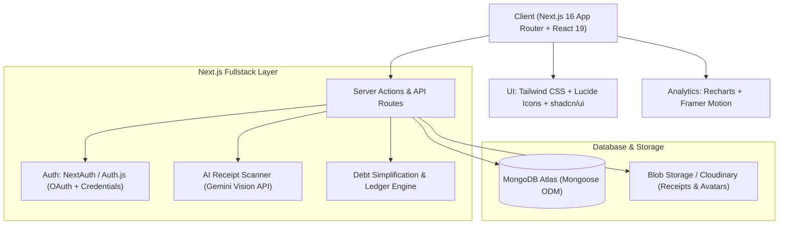
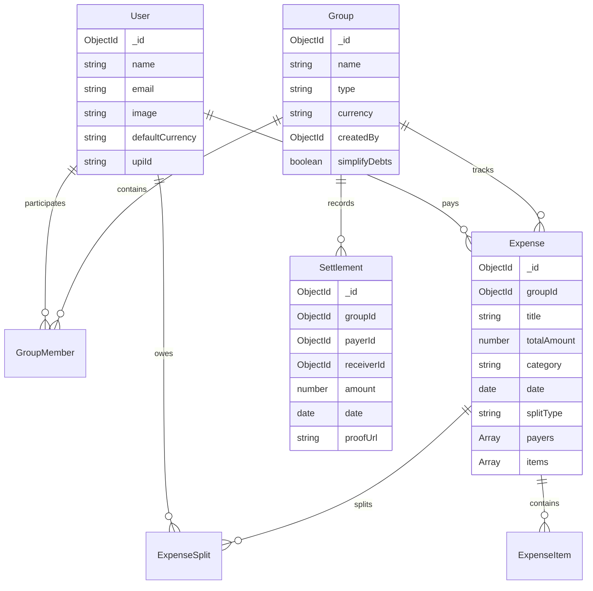
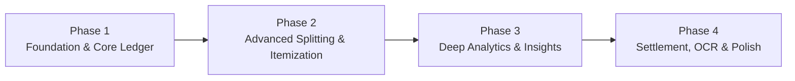

# SplitMadi: Modern Expense Splitting & Financial Analytics Platform
## System Architecture, Design Spec & Phased Execution Plan

---

## 1. Problem Statement & Competitive Edge

Splitwise has stagnated with an outdated UI, aggressive paywalls (Splitwise Pro limits receipt scanning, search, and charts), poor multi-person itemization, and almost zero actionable financial analytics.

### Splitwise vs. SplitMadi Comparison

| Feature | Splitwise (Free / Pro) | SplitMadi |
| :--- | :--- | :--- |
| **User Interface** | Cluttered, 2014-era mobile web wrapper | Modern fintech aesthetic (Tailwind CSS, Radix/shadcn, dark/light mode, mobile-first) |
| **Analytics & Stats** | Bare minimum total balance, basic charts paywalled | **Deep Per-Person Analytics**: Category breakdown, spending DNA, net balances, debt flow diagrams, month-over-month trends |
| **Itemized Bill Splitting** | Paywalled or cumbersome manual calculation | **Item-Level Splitting**: Assign dishes/items to specific people, auto-distribute tax, tip, and discounts proportionally |
| **Per-Person Expense View** | Difficult to see what *you* personally consumed | Dedicated personal dashboard: "What I spent" vs. "What I paid for others" vs. "What I owe" |
| **Debt Simplification** | Basic algorithm, often paywalled in groups | Built-in Min-Cash-Flow graph algorithm with live interactive visualization and toggle |
| **Settlement Experience** | Manual marked as paid; generic links | Quick UPI QR code generation (instant scanning), payment proof upload, settlement history |
| **Receipt Scanning** | Restricted to Pro with daily limits | Integrated OCR (AI-powered item & tax extraction) |
| **Speed & UX** | Slow modal workflows | Instant keyboard shortcuts, optimistic updates, frictionless "Quick Add" modal (< 5 seconds) |

---

## 2. Core Feature Specifications

### 2.1 Multi-Mode Expense Splitting Engine
- **Equal Split**: Split evenly across all or selected members.
- **Exact Amounts**: Specify exact dollar/rupee amounts per person with live remaining-balance validator.
- **Percentages & Shares**: Ratio-based splitting (e.g., Alice 2 shares, Bob 1 share).
- **Itemized Bill Breakdown**:
  - Add line items (e.g., Pizza \$18, Burger \$12, Drinks \$15).
  - Assign 1 or more consumers per item.
  - Automatically calculate subtotal, tip (fixed or %), tax, and discounts, splitting service charges proportionally.
- **Multi-Payer Support**: Split who paid (e.g., Alice paid \$40, Bob paid \$20 for a \$60 bill).

### 2.2 Advanced Analytics & Personal Insights ("The Missing Splitwise Feature")
- **Per-Person Spending DNA**:
  - Personal net burn (my actual consumption vs. my payments).
  - Category breakdown per user (Food, Travel, Rent, Utilities, Entertainment, Groceries).
  - Historical spending timeline & monthly comparison.
- **Group Financial Health**:
  - Total group burn rate and category distribution.
  - Balance matrix & Debt Sankey/Graph visualization (showing who owes whom cleanly).
  - Spending velocity: Are group expenses accelerating this month?
- **Export & Reports**: One-click PDF summaries and CSV data export for monthly auditing.

### 2.3 Intelligent Debt Simplification
- Graph-based settlement optimizer: reduces a group with 15 cross-debts down to the mathematical minimum 3-4 transactions.
- Option to toggle simplification per group (some friends prefer direct 1-to-1 settlements).

### 2.4 Quick Settlement & Payment Bridges
- **Direct UPI / Payment Deep-links**: Dynamically generate UPI QR codes with exact amount and payee VPA for instant zero-fee settlement.
- **Payment Verification**: Upload payment screenshot or transaction ID.
- **Partial Settlements**: Support paying down partial debts.

---

## 3. Tech Stack Architecture

- **Frontend & Server Framework**: Next.js (App Router, Server Components for performance, Server Actions for mutations).
- **Database**: MongoDB with Mongoose (document structure is natural for groups, arrays of splits, itemized bills, and nested member balances).
- **Styling & UI Components**: Tailwind CSS, Radix UI primitives / shadcn-style components, Lucide-react icons.
- **Data Visualizations**: Recharts for responsive bar/pie/area charts, custom SVG/Canvas for Debt Flow diagrams.
- **Authentication**: Auth.js / NextAuth (Google OAuth + Email/Password).
- **Validation**: Zod (shared client & server validation schemas).

---

## 4. MongoDB Schema Design

### Key Models

1. **`User`**: Profile, email, avatar, preferred currency (USD, INR, EUR, etc.), payment handles (UPI VPA / PayPal tag).
2. **`Group`**: Group name, avatar/icon, category (Trip, Home, Couple, Project, Other), members array (role, balance summary cache), debt simplification settings.
3. **`Expense`**:
   - `groupId` (optional, can be direct 1-to-1 expense)
   - `title`, `notes`, `category`, `date`, `receiptUrl`
   - `totalAmount`, `currency`
   - `payers`: Array of `{ userId, amount }` (supports multi-payer)
   - `splitType`: `'EQUAL' | 'EXACT' | 'PERCENT' | 'SHARES' | 'ITEMIZED'`
   - `splits`: Array of `{ userId, amount, share, percentage }`
   - `items`: Array of `{ name, price, assignedTo: [userId] }`
   - `tax`, `tip`, `discount`
4. **`Settlement`**: Records balance clearances between two users (`payerId`, `receiverId`, `amount`, `notes`, `proofUrl`).
5. **`Activity`**: Audit trail for group actions (added expense, updated expense, settled up, member joined).

---

## 5. Phased Roadmap

### **Phase 1: Foundation & Core Ledger Engine**
- **Objective**: Rock-solid base with authentication, group creation, and basic expense tracking.
- **Tasks**:
  1. Setup MongoDB connection helper with caching for Next.js App Router.
  2. Implement Authentication (Credentials + Google OAuth via NextAuth / Auth.js).
  3. UI Design System foundation: Color tokens, dark/light mode toggle, Navbar, Sidebar, and card components.
  4. Core Models: User, Group, Expense, Settlement.
  5. Group Dashboard: Create groups, invite members via link/email, view current member net balances.
  6. Basic Expense Creation: Equal and Exact splits with instant balance updates.

### **Phase 2: Advanced Splitting & Itemized Bills**
- **Objective**: Solve Splitwise's biggest functional shortcomings in complex bill scenarios.
- **Tasks**:
  1. Percentage & Shares splitting modes with dynamic input validation.
  2. **Itemized Bill Splitter**:
     - UI to add individual bill line items.
     - Multi-select member assignment chips per item.
     - Auto-distribution algorithm for tax, tip, and platform charges.
  3. Multi-Payer Split modal: Allow 2 or more people to pay portions of a single bill.
  4. Debt Simplification Engine: Min-cash-flow algorithm reducing redundant circular transfers.

### **Phase 3: Deep Per-Person Analytics & Financial Dashboard**
- **Objective**: Provide the visual intelligence and insights Splitwise completely lacks.
- **Tasks**:
  1. **Personal Financial DNA Page**:
     - Real spending vs. payments vs. pending debt.
     - Category breakdown doughnut chart (Food, Travel, Rent, Utilities, etc.).
     - Monthly spending trajectory (Area chart over time).
  2. **Group Analytics Tab**:
     - Group total burn, daily spending trends.
     - Top contributors and highest category expenses.
     - Visual Debt Graph: Interactive diagram showing who owes whom.
  3. Export functionality: Download monthly report as CSV or printable PDF.

### **Phase 4: Settlements, OCR Receipt Scanner & Production Polish**
- **Objective**: Effortless repayments, automated receipt ingestion, and high-end polish.
- **Tasks**:
  1. Smart Settlement Workflow:
     - Settle-up modal suggesting optimal repayment paths.
     - Dynamic UPI QR Code generation for instant 1-tap mobile payment.
     - Upload receipt/payment screenshot attachment.
  2. AI Receipt OCR:
     - Upload receipt image -> Extract items, amounts, taxes automatically -> Pre-fill Itemized Split form.
  3. Activity Feed & Audit History (view edit history for any expense).
  4. Mobile responsiveness & PWA readiness (offline cache, install to home screen).

---

## 6. UI/UX Aesthetic Blueprint

- **Theme & Vibe**: Crisp, modern fintech layout inspired by Linear and modern banking apps.
- **Palette**: Deep slate/zinc dark mode, clean pearl light mode, vibrant emerald green for positive balances (+you are owed) and warm rose/crimson for debts (-you owe).
- **Micro-Interactions**:
  - `CMD+K` / Quick Add button accessible globally from any page.
  - Live calculations: changing a split percentage immediately animates the exact currency figures.
  - Floating bottom navigation on mobile with ergonomic thumb targets.
